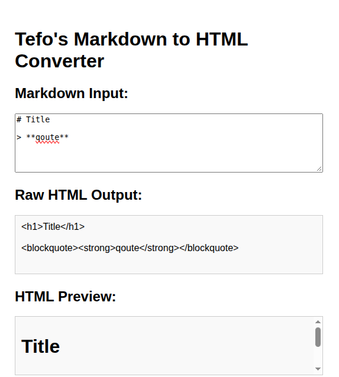

# Markdown to HTML Converter

[Live Demo](https://tefol-hub.github.io/freeCodeCamp-Projects-and-Certs/Javascript-Certification/markdown-to-html-converter/)
[Lab Instructions](https://www.freecodecamp.org/learn/javascript-v9/lab-markdown-to-html-converter/build-a-markdown-to-html-converter)

## 📸 Preview

## 🎯 Project Goals
* **Objective:** Build a real-time Markdown-to-HTML parser utilizing regular expressions to convert basic markup syntax into structured HTML elements.
* **Regex Pattern Mapping:** Implemented pattern matching rules for headings (`#`, `##`, `###`), blockquotes (`>`), bold text (`**`, `__`), italic text (`*`, `_`), images (``), and links (`[text](url)`).
* **Real-Time Parsing Pipeline:** Attached `input` event listeners to concurrently update raw string outputs (`#html-output`) and live rendered elements (`#preview`).
* **String Replacement Logic:** Applied global regular expression substitution (`.replace()`) coupled with capture group referencing.

## 🛠️ Technologies Used
* **JavaScript (ES6):** Regular Expressions (`RegExp`), string replacement callbacks, DOM event handling (`input`), element property mapping (`textContent`, `innerHTML`).
* **HTML5:** Semantic form inputs (`<textarea>`), output display containers (`
`).
* **CSS3:** Flexible multi-column grid/flexbox layouts, responsive scaling, scrollable output boxes.

## 🚀 How to Run
1. Navigate to: `cd Javascript-Certification/markdown-to-html-converter`
2. Open `index.html` in your browser.
3. Type or paste Markdown syntax into the input box to see live HTML code generation and visual rendering.