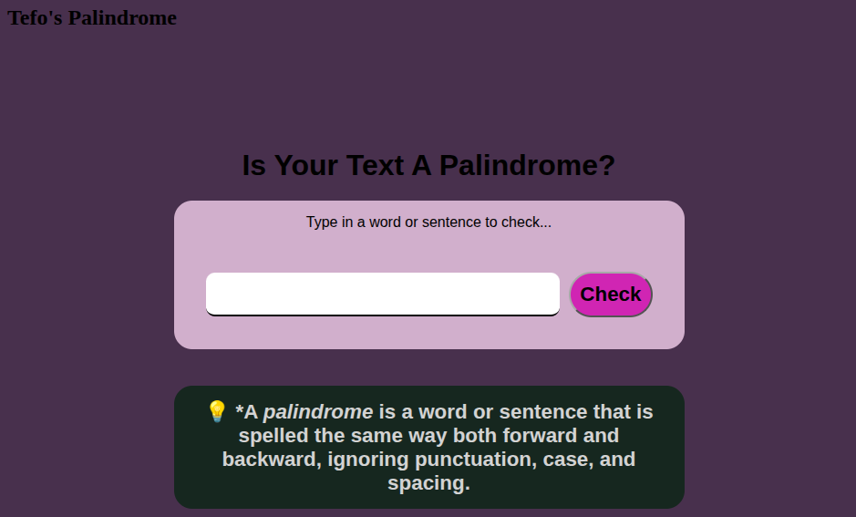

# Palindrome Checker

[Live Demo](https://tefol-hub.github.io/freeCodeCamp-Projects-and-Certs/Javascript-Certification/palindrome-checker/)
[Lab Instructions](https://www.freecodecamp.org/learn/javascript-v9/lab-palindrome-checker/build-a-palindrome-checker)

## 📸 Preview

## 🎯 Project Goals
* **Objective:** Build an interactive application that validates whether a user-submitted string is a palindrome while ignoring casing, spacing, and non-alphanumeric symbols.
* **Regex Sanitation:** Employed a global negative character class regex (`/[^a-zA-Z0-9]/g`) to purge punctuation, symbols, and underscores prior to evaluation.
* **String Inversion & Comparison:** Transformed sanitized strings to lower case and evaluated parity against inverted character sequences constructed via `.split('').reverse().join('')`.
* **Input Validation & Feedback:** Added alert guards for empty submissions and updated DOM output elements dynamically with contextual results.

## 🛠️ Technologies Used
* **JavaScript (ES6):** Regular Expressions (`RegExp`), string manipulation (`.replace()`, `.toLowerCase()`), array operations (`.split()`, `.reverse()`, `.join()`), DOM manipulation.
* **HTML5:** Input controls (`<input>`, `<button>`), label accessibility (`<label for="...">`), semantic content structure.
* **CSS3:** Responsive Flexbox layouts, focus states, custom palette styling, media queries.

## 🚀 How to Run
1. Navigate to: `cd Javascript-Certification/palindrome-checker`
2. Open `index.html` in your browser.
3. Enter any word, phrase, or symbol sequence into the input field and click **Check** to view the palindrome evaluation.