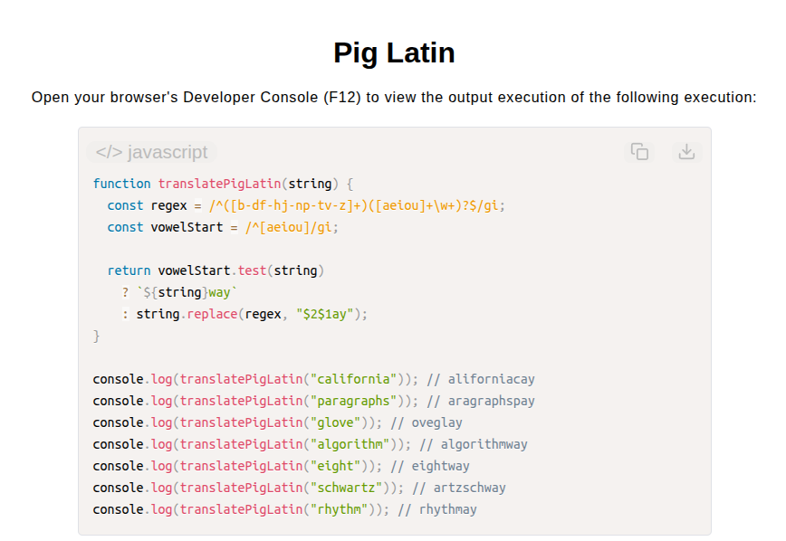

# Pig Latin Translator

[Live Demo](https://tefol-hub.github.io/freeCodeCamp-Projects-and-Certs/Javascript-Certification/pig-latin/)
[Lab Instructions](https://www.freecodecamp.org/learn/javascript-v9/lab-pig-latin/lab-pig-latin)

## 📸 Preview

## 🎯 Project Goals
* **Objective:** Translate English words into Pig Latin based on whether they begin with vowels, consonant clusters, or contain no vowels at all.
* **Regex Pattern Matching:** Utilized regular expression character classes (`[b-df-hj-np-tv-z]+` and `[aeiou]`) to isolate consonant clusters and vowel starting points.
* **String Transformation:** Reordered matched capture groups (`$2$1ay`) or appended suffix rules (`way` / `ay`) dynamically.
* **Edge-Case Handling:** Ensured strings lacking traditional vowels (e.g., `"rhythm"`) receive proper suffix formatting.

## 🛠️ Technologies Used
* **JavaScript (ES6):** Regular Expressions (`RegExp`), string replacement patterns (`.replace()`), conditional ternary logic.
* **HTML5:** User interface presentation.
* **CSS3:** Layout styling, modern color variables, typography.

## 🚀 How to Run
1. Navigate to: `cd Javascript-Certification/pig-latin`
2. Open `index.html` in your browser.
3. Access your **Developer Console (F12)** to test custom Pig Latin string translations.