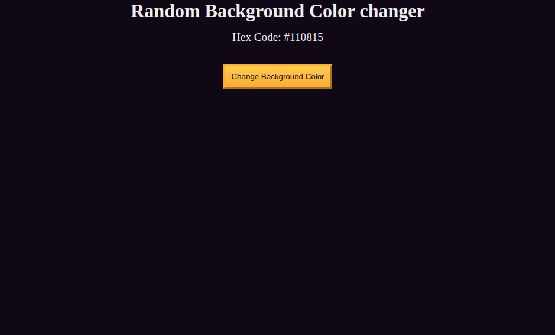

# Random Background Color Changer

[Live Demo](https://tefol-hub.github.io/freeCodeCamp-Projects-and-Certs/Javascript-Certification/random-background-color-changer/)
[Lab Instructions](https://www.freecodecamp.org/learn/javascript-v9/lab-random-background-color-changer/debug-a-random-background-color-changer)

## 📸 Preview

## 🎯 Project Goals
* **Objective:** Debug an existing JavaScript project by addressing syntax errors, reference errors, DOM selector type errors, and event listener function execution logic.
* **Syntax & Case Fixes:** Corrected string array formatting and replaced invalid `math` object references with JavaScript's native capitalized `Math` object.
* **Array Index Calculation:** Computed whole-number array indices using `Math.floor(Math.random() * array.length)`.
* **DOM Query Correction:** Fixed `querySelector` target strings using valid CSS ID syntax (`#bg-hex-code`, `#btn`).
* **Event Listener Reference:** Passed function references rather than immediate function calls inside `addEventListener("click", changeBackgroundColor)`.

## 🛠️ Technologies Used
* **JavaScript (ES6):** Debugging techniques, DOM selection (`querySelector`), `Math.random()`, `Math.floor()`, event handling.
* **HTML5:** Basic structural markup (`<main>`, `<section>`, `<button>`, ``).
* **CSS3:** Custom properties (`:root`), linear gradients, custom button hover styling.

## 🚀 How to Run
1. Navigate to: `cd Javascript-Certification/random-background-color-changer`
2. Open `index.html` in your browser.
3. Click the **Change Background Color** button to randomly switch background hex colors and update the onscreen hex display.