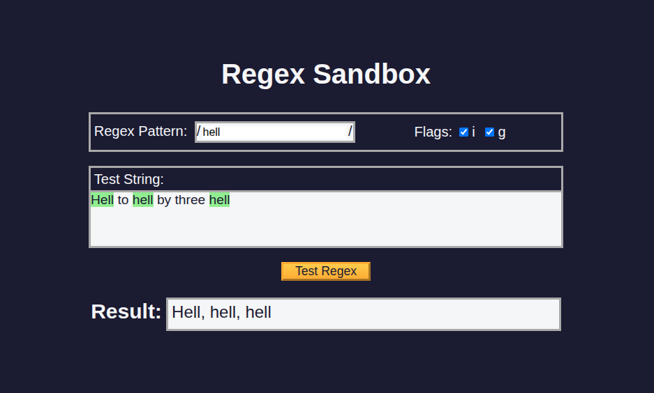

# RegEx Sandbox

[Live Demo](https://tefol-hub.github.io/freeCodeCamp-Projects-and-Certs/Javascript-Certification/regex-sandbox/)
[Lab Instructions](https://www.freecodecamp.org/learn/javascript-v9/lab-regex-sandbox/lab-regex-sandbox)

## 📸 Preview

## 🎯 Project Goals
* **Objective:** Build an interactive regular expression testing utility that dynamically evaluates patterns against user-editable text, highlights matching substrings, and lists extracted results.
* **Dynamic RegExp Construction:** Instantiated runtime regular expression objects using `new RegExp(pattern, flags)` combined with dynamic flag states.
* **Flag Extraction Utility:** Implemented a `getFlags()` function evaluating checked status checkboxes (`#i` for case-insensitive, `#g` for global searches).
* **Highlighting & Result Reporting:** Replaced matching string substrings with highlighted HTML spans and reported comma-separated matches or fallback `"no match"` states.

## 🛠️ Technologies Used
* **JavaScript (ES6):** Dynamic `RegExp` constructor, string methods (`.replace()`, `.match()`), DOM manipulation (`contenteditable`, `innerHTML`, `textContent`).
* **HTML5:** Content-editable text containers, checkbox form inputs, semantic layout structure.
* **CSS3:** Flexbox layout styling, custom CSS variables (`:root`), highlight background styling.

## 🚀 How to Run
1. Navigate to: `cd Javascript-Certification/regex-sandbox`
2. Open `index.html` in your browser.
3. Enter a regex pattern, check desired flags, type a test string, and click **Test Regex** to view highlights and match results.