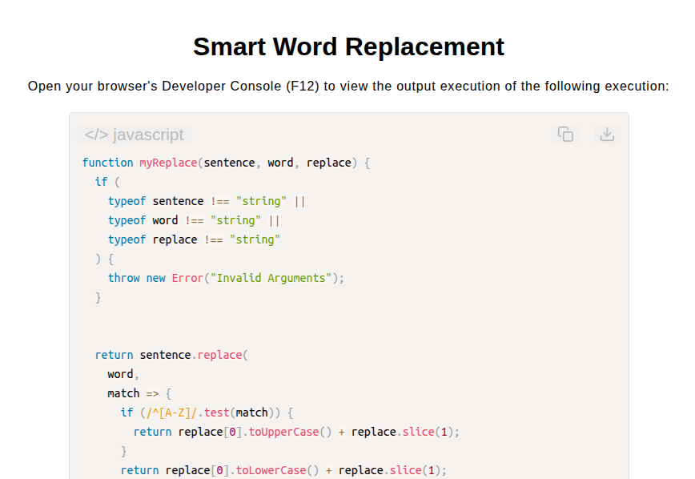

# Smart Word Replacement Function

[Live Demo](https://tefol-hub.github.io/freeCodeCamp-Projects-and-Certs/Javascript-Certification/smart-word-replacement/)
[Lab Instructions](https://www.freecodecamp.org/learn/javascript-v9/lab-smart-word-replacement/build-a-smart-word-replacement-function)

## 📸 Preview

## 🎯 Project Goals
* **Objective:** Perform a search-and-replace operation within a sentence while preserving the original casing of the first character of the replaced word.
* **Input Validation:** Guarded function execution by validating that all three input arguments (`sentence`, `word`, `replace`) are valid strings.
* **Case Preservation Logic:** Utilized regular expression test patterns (`/^[A-Z]/`) to detect uppercase initial characters and transform replacement words accordingly.
* **String Replacement:** Replaced target substrings using `String.prototype.replace()` with dynamic mapping callbacks.

## 🛠️ Technologies Used
* **JavaScript (ES6):** Regular Expressions (`RegExp`), string manipulation methods (`.replace()`, `.toUpperCase()`, `.toLowerCase()`, `.slice()`), type checking.
* **HTML5:** User interface presentation framework.
* **CSS3:** Component styling, layout styling, typography.

## 🚀 How to Run
1. Navigate to: `cd Javascript-Certification/smart-word-replacement`
2. Open `index.html` in your browser.
3. Access your **Developer Console (F12)** to test custom sentence search and case-preserving replacements.