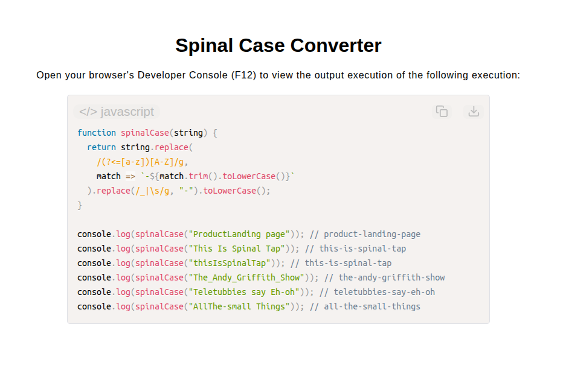

# Spinal Case Converter

[Live Demo](https://tefol-hub.github.io/freeCodeCamp-Projects-and-Certs/Javascript-Certification/spinal-case-converter/)
[Lab Instructions](https://www.freecodecamp.org/learn/javascript-v9/lab-spinal-case-converter/implement-a-spinal-case-converter)

## 📸 Preview

## 🎯 Project Goals
* **Objective:** Convert strings of varying formats (camelCase, snake_case, space-separated) into spinal case (all lowercase words separated by hyphens).
* **Lookbehind Assertions:** Leveraged positive lookbehind regex (`(?<=[a-z])[A-Z]`) to identify camelCase boundaries without consuming characters.
* **Character Substitution:** Replaced underscores (`_`) and whitespace (`\s`) with hyphen separators (`-`).
* **Normalization:** Converted all extracted string segments to lower case for uniform spinal case formatting.

## 🛠️ Technologies Used
* **JavaScript (ES6):** Regular Expressions (`RegExp`, lookbehinds), string replacement (`.replace()`), case normalization (`.toLowerCase()`).
* **HTML5:** User interface structural presentation.
* **CSS3:** Custom layout styles, typography, responsive design.

## 🚀 How to Run
1. Navigate to: `cd Javascript-Certification/spinal-case-converter`
2. Open `index.html` in your browser.
3. Access your **Developer Console (F12)** to test custom string conversions into spinal case.