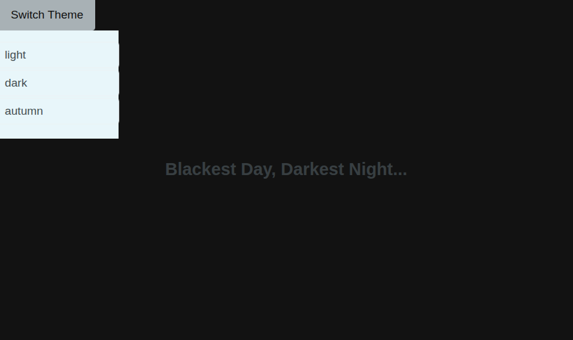

# Theme Switcher

[Live Demo](https://tefol-hub.github.io/freeCodeCamp-Projects-and-Certs/Javascript-Certification/theme-switcher/)
[Lab Instructions](https://www.freecodecamp.org/learn/javascript-v9/lab-theme-switcher/lab-theme-switcher)

## 📸 Preview

## 🎯 Project Goals
* **Objective:** Construct an accessible theme switcher UI utilizing ARIA menu semantics, dynamic attribute toggling, and live region screen reader announcements.
* **ARIA Menu Semantics:** Configured explicit attributes (`aria-haspopup="true"`, `aria-expanded`, `aria-controls`, `role="menu"`, `role="menuitem"`, `aria-labelledby`) to expose popup menu controls to assistive technologies.
* **Live Region Announcements:** Utilized `aria-live="polite"` elements to communicate dynamic theme change status updates automatically to screen reader users without interrupting flow.
* **State & Class Mutation:** Dynamically updated `hidden` attributes, `aria-expanded` booleans, and `body` class names (`theme-light`, `theme-dark`, `theme-autumn`) upon menu interactions.

## 🛠️ Technologies Used
* **JavaScript (ES6):** DOM manipulation (`querySelector`, `getElementById`), attribute toggling (`setAttribute`, `hasAttribute`), array matching (`.find()`), event delegation.
* **HTML5:** Accessible semantics, ARIA roles and state attributes (`aria-live`, `aria-expanded`, `aria-haspopup`, `aria-controls`).
* **CSS3:** Theme class scoping (`.theme-light`, `.theme-dark`, `.theme-autumn`), CSS transitions for smooth background/color shifts, hover states.

## 🚀 How to Run
1. Navigate to: `cd Javascript-Certification/theme-switcher`
2. Open `index.html` in your browser.
3. Click **Switch Theme** to toggle the dropdown menu and select a theme to update the page theme and live announcements.
